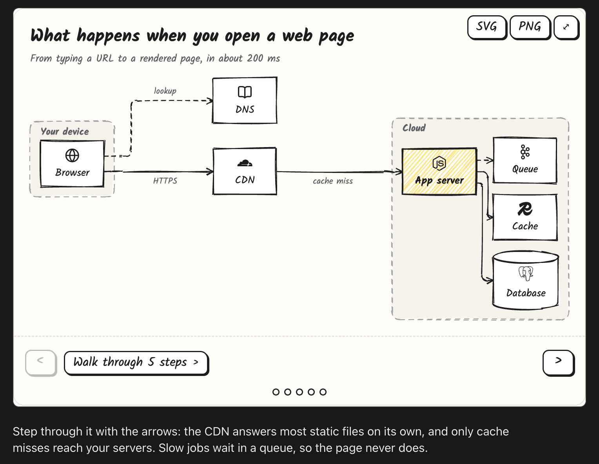
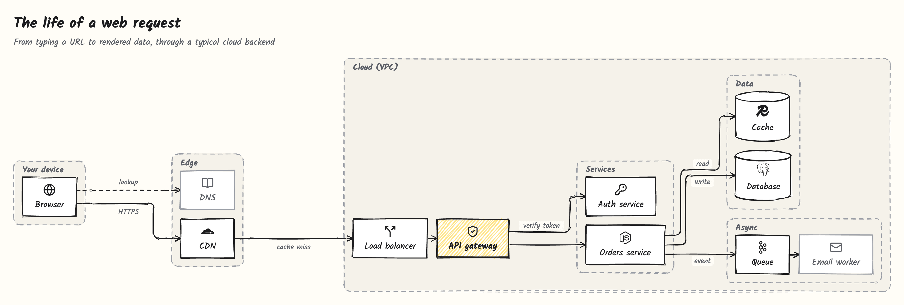
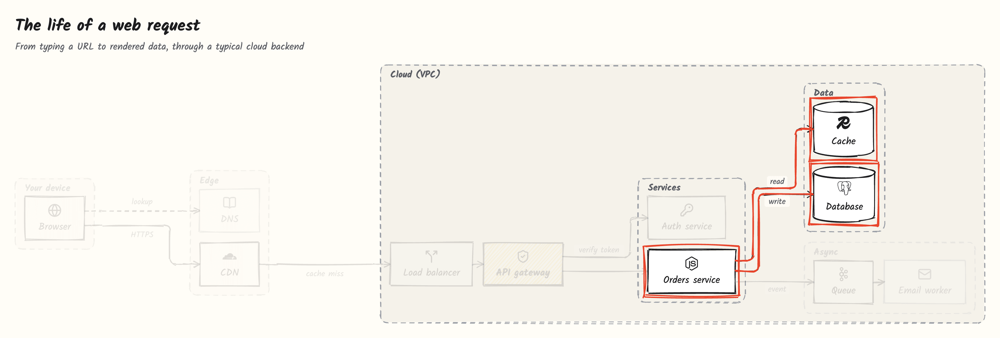
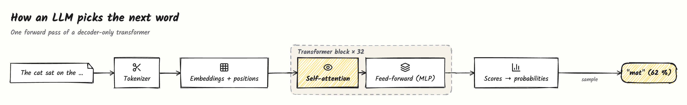
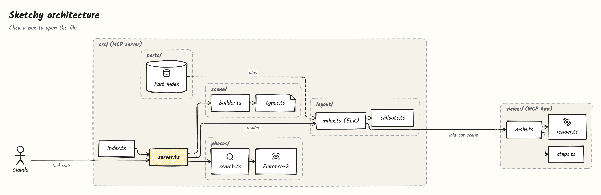
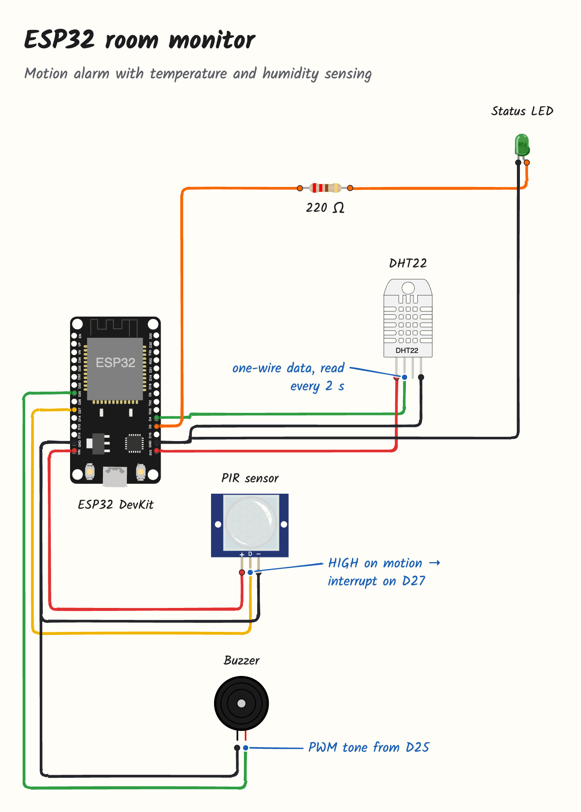
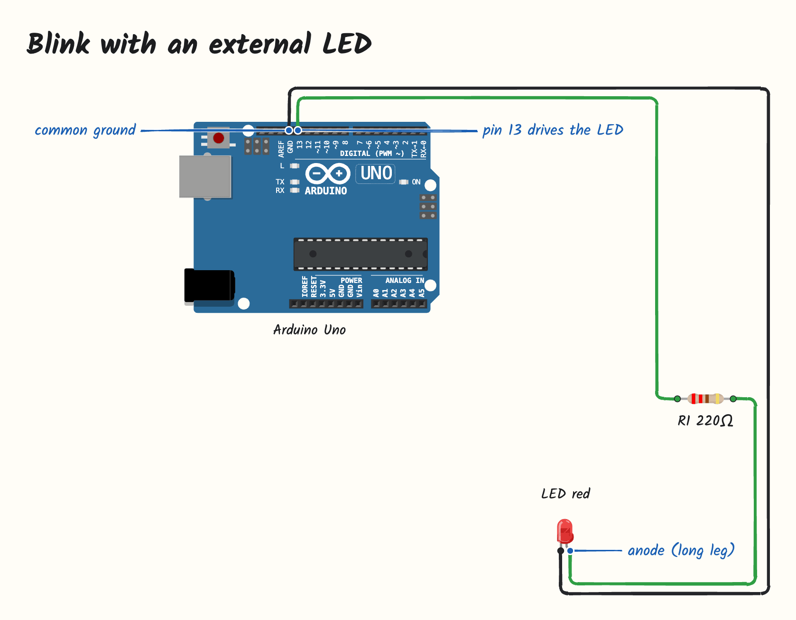
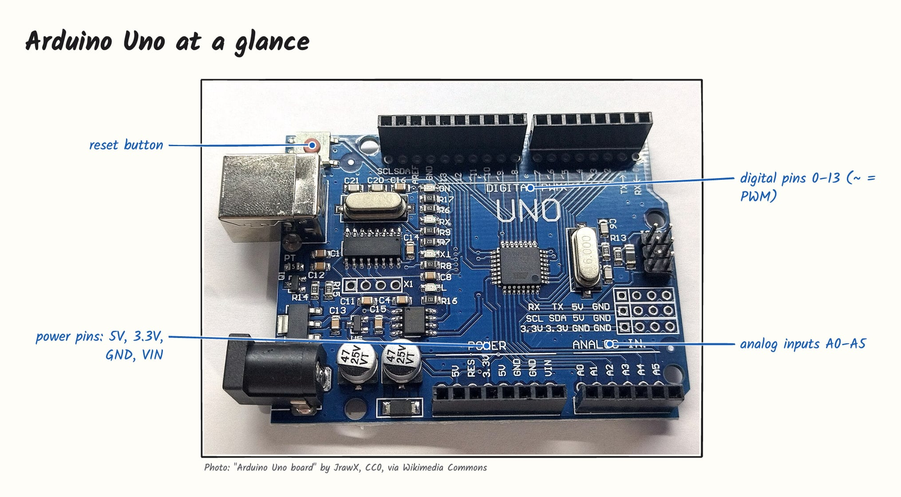
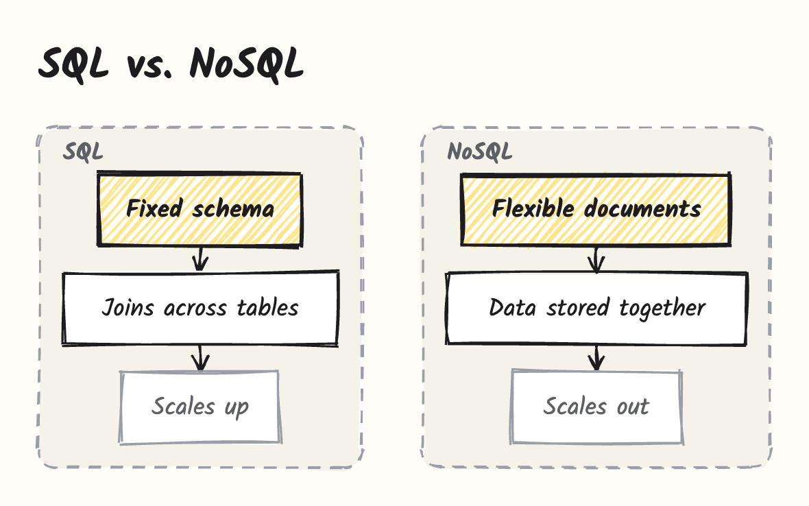
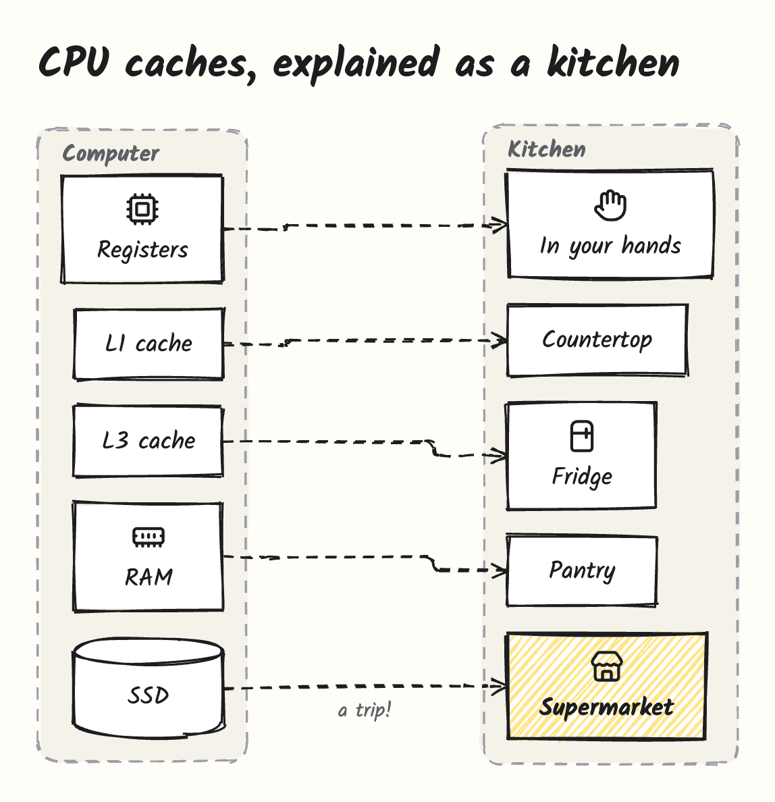

# Sketchy (fork)

> Fork of [ddkbs/sketchy](https://github.com/ddkbs/sketchy) with a pinned, integrity-checked CDN bundle, safer scene embedding, parser fixes and a tighter SKILL.md. See [FORK_CHANGES.md](FORK_CHANGES.md), especially "Building your release": the upstream install steps below assume upstream's release zips.

Sketchy lets Claude **draw while it explains**: clean, hand-drawn, interactive diagrams rendered right next to the answer. It works in the Claude chat as a skill and in Claude Code as an [MCP](https://modelcontextprotocol.io) server.

Claude decides **what** to draw and label. Sketchy decides **where**: a part library with named anchor points and automatic layout. Claude never computes coordinates, so drawings come out precise and consistent every time.



## What it can draw

### Systems, step by step

Ask _"What happens when I open a web page?"_ and Claude draws the whole path, then walks you through it. Each step circles what matters in red pen and fades the rest. Use the buttons or the arrow keys.





### Concepts from computer science and machine learning

Sketchy is not limited to hardware. Structure, flow, comparison and metaphor patterns cover any topic, from transformers to TCP.



### Your own code

Ask _"Explain my repo"_. Claude reads the code and draws modules, folders and data flow. **Click a box to open the file** in VS Code, Cursor, Windsurf or Zed; hover to see what it does.



### Circuits from Arduino and ESP32 sketches

Ask _"How is my sketch wired?"_. Claude reads `pinMode`, `digitalWrite` and friends, places real parts (50 boards, sensors, displays and modules from [wokwi-elements](https://github.com/wokwi/wokwi-elements)) and connects pins by name. Sketchy routes the wires and places the callouts.

<table>
  <tr>
    <td width="58%"></td>
    <td width="42%"></td>
  </tr>
</table>

### Labeled photos

Claude finds a freely licensed photo (Wikimedia Commons, Openverse), and a vision model **running on your computer** ([Florence-2](https://huggingface.co/microsoft/Florence-2-base-ft)) locates the parts and printed text to label. Attribution is always shown.



### Comparisons and metaphors

<table>
  <tr>
    <td width="50%"></td>
    <td width="50%"></td>
  </tr>
</table>

### Interactive, exportable

- **Hover** any box, pin or wire for details.
- **Click** a code node to open the file, or a photo credit to open its source.
- **Export** as **SVG** or **PNG**, fonts included: your system's save dialog asks where to put the file.
- **Fullscreen** where the host supports it.

## Install

Where do you use Claude? Sketchy comes two ways, and both can be installed side by side:

- **In the chat** (web, desktop and mobile): the skill. Nothing to install locally.
- **While coding** (Claude Code in the desktop app or terminal): the extension, which adds photo labeling, SVG and PNG export and click-to-open files.

### Claude chat (web, desktop and mobile)

The skill draws right in the chat, with no server:

1. Download `sketchy-skill-<version>.zip` from the [latest release](https://github.com/ddkbs/sketchy/releases/latest).
2. In Claude, open **Settings → Capabilities → Skills** and upload the zip.
3. Ask for a drawing in any chat.

Claude writes the scene, and the chat's inline visualization loads Sketchy's browser bundle from [jsDelivr](https://www.jsdelivr.com), which serves it from this repository's `cdn` branch. The skill follows the current minor version, so it picks up fixes without being uploaded again. Photo labeling and opening files from a drawing need your computer, so they stay in the desktop extension.

### Claude desktop app (Code tab)

1. Download the `.mcpb` file for your platform from the [latest release](https://github.com/ddkbs/sketchy/releases/latest) (macOS on Apple Silicon, Windows or Linux).
2. Double-click it (or drag it into **Settings → Extensions**) and confirm.
3. Optional: in the extension settings choose your editor and where Sketchy stores its data.
4. Open the **Code** tab and start a session. Drawings appear inline next to Claude's answer.

The **Chat** tab does not display views from locally installed extensions; use the skill above there.

The photo-labeling model is **not** part of the download. The first time Claude labels a photo, Sketchy asks you to pick a model size:

| Model  | Download | Memory  | Notes                                     |
| ------ | -------- | ------- | ----------------------------------------- |
| Small  | ~280 MB  | ~1 GB   | Recommended. Printed text, distinct parts |
| Medium | ~830 MB  | ~2.5 GB | Better grounding of small parts           |
| Large  | ~3.1 GB  | ~4.5 GB | Most precise                              |

### Claude Code in the terminal

The terminal `claude` does not use desktop extensions, so register Sketchy once for all your projects:

```bash
git clone https://github.com/ddkbs/sketchy.git
cd sketchy && npm install && npm run build
claude mcp add sketchy --scope user -- node "$PWD/dist/index.js"
```

Run `claude mcp list` to check that it is connected.

### Other MCP clients

Sketchy is a standard MCP server and works in any client that supports [MCP Apps](https://github.com/modelcontextprotocol/ext-apps):

```json
{
  "mcpServers": {
    "sketchy": {
      "command": "node",
      "args": ["/path/to/sketchy/dist/index.js"],
      "env": { "SKETCHY_EDITOR": "cursor" }
    }
  }
}
```

## Try it

- _"What happens when I open a web page? Walk me through it."_
- _"How does an LLM pick the next word?"_
- _"Explain the architecture of /path/to/my/repo, then walk me through one request."_
- _"How is this sketch wired?"_ followed by your `.ino` file
- _"Show me a photo of a Raspberry Pi and label the ports."_
- _"Compare TCP and UDP."_
- _"Explain CPU caches with an everyday metaphor."_

The same patterns are available as prompts: `explain-structure`, `explain-flow`, `compare`, `metaphor`, `explain-repo` and `explain-circuit`.

## How it works

```
Claude describes the scene (extension: tools like sketch, place_part, label;
                            skill: the same scene as JSON in an inline widget)
          ↓
Scene: nodes, groups, parts, wires, labels, photos, steps — no coordinates
          ↓
Layout engine (elkjs): positions, orthogonal routing, collision-free callouts
          ↓
Viewer: hand-drawn rendering with rough.js, hover, steps, export
```

Every feature fills the same scene, and a single viewer renders it. The visual style lives in the renderer, so every drawing looks consistent no matter what Claude asks for. The extension runs layout in its server process and shows the viewer as an MCP App; the skill runs the same code in the browser from a bundle on jsDelivr.

<details>
<summary>Tools</summary>

| Tool                                   | Purpose                                                    |
| -------------------------------------- | ---------------------------------------------------------- |
| `sketch`                               | Draw a whole scene in one call, in the compact line syntax |
| `search_parts`                         | Electronic part types and their pins                       |
| `find_image`, `locate`, `choose_model` | Photo search, local grounding, model setup                 |

A scene is a few short lines: `browser Browser @globe`, `browser -> server HTTPS`, `step Request: The browser asks | browser browser->server`. Setting `SKETCHY_FORMAT=json` restores the JSON `sketch` tool and the incremental tools of earlier versions (`add_node`, `add_edge`, `place_part`, `label`, `render`, …).

</details>

### Follow-ups

Ask Claude to change a drawing ("add the cache and the call back to the router") and it sends the scene again with the same ids. Sketchy keeps the order and places of everything the earlier drawing already showed and fits the new parts in around them, so before and after stay comparable, also when a back-edge closes a cycle.

## Token usage

Does a drawing cost more than a text answer? We asked Claude Sonnet to explain five topics (DNS, git branches, transformers, the TLS handshake, an Arduino button circuit), in plain text and with Sketchy, and read the exact usage Claude Code reports. Version 0.1.6 introduced the compact scene format; the JSON column is the format before it.

| Average per answer, fresh conversation | Plain text | Sketchy, JSON (≤ 0.1.5) | Sketchy, compact (0.1.6) |
| -------------------------------------- | ---------- | ----------------------- | ------------------------ |
| Output tokens (what Claude writes)     | 962        | 1,168                   | **686** (−29% vs. text)  |
| Tool definitions                       | –          | ~4,100                  | **~500**                 |
| Cost on Sonnet list prices             | ~$0.034    | ~$0.059                 | ~$0.043                  |

Over a whole session the compact format is cheaper than plain text. Six questions in a row, each variant in its own session, mean of two runs:

| Answers in the session | Plain text | Sketchy, JSON | Sketchy, compact |
| ---------------------- | ---------- | ------------- | ---------------- |
| 1                      | $0.04      | $0.07         | $0.05            |
| 3                      | $0.21      | $0.27         | **$0.20**        |
| 6                      | $0.61      | $0.75         | **$0.58**        |

- **Claude writes less for a drawing than for text.** Layout and drawing happen in Sketchy and cost no tokens.
- **Every answer stays in the history.** Shorter answers keep it small, so each follow-up question costs less than after a text answer.
- **A tool call adds a turn** that re-sends the context, mostly from the cache at a tenth of the price; this is why the very first answer still costs a little more than text.

Measured on November 2, 2026 in Claude Code with an empty project. Run it yourself with `npm run build && node scripts/token-benchmark.mjs`.

## Configuration

| Variable             | Default       | Description                                                                       |
| -------------------- | ------------- | --------------------------------------------------------------------------------- |
| `SKETCHY_EDITOR`     | `vscode`      | Editor for file links: `vscode`, `cursor`, `windsurf`, `vscode-insiders`, `zed`   |
| `SKETCHY_PHOTOS`     | `on`          | `off` disables photo search and labeling                                          |
| `SKETCHY_DATA_DIR`   | `~/.sketchy`  | Models, cached photos and the local SQLite database                               |
| `SKETCHY_EXPORT_DIR` | `~/Downloads` | Folder the save dialog opens in, and where exports go when no dialog is available |
| `SKETCHY_FORMAT`     | `compact`     | `json` restores the JSON scene tools of earlier versions                          |

## Development

Requires Node.js 20 or later.

```bash
npm install
npm run build      # part catalog, server and viewer
npm test
npm run preview    # viewer with sample scenes at http://localhost:5173/preview.html
npm run pack       # .mcpb bundle for the current platform
npm run build:skill  # chat skill zip
npm run build:web    # browser bundle that the skill loads
```

See [CONTRIBUTING.md](CONTRIBUTING.md) for the project layout.

## License

[MIT](LICENSE) © ddkbs. Sketchy builds on open-source work listed in [THIRD_PARTY_NOTICES.md](THIRD_PARTY_NOTICES.md).
